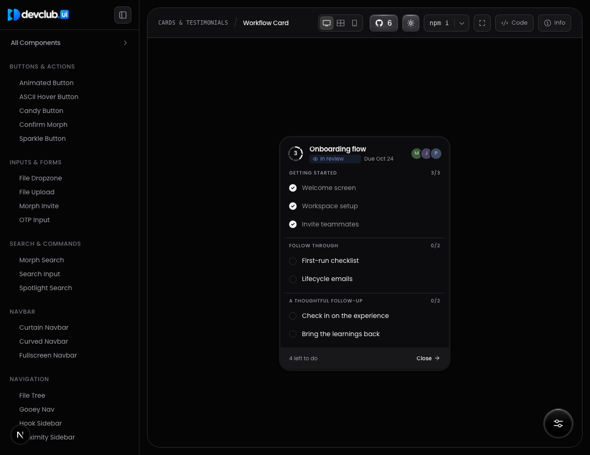
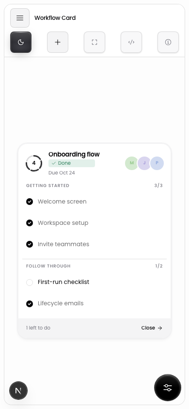

<div align="center">

<picture>
  <source media="(prefers-color-scheme: dark)" srcset="public/logo/WHITE-LOGO.png">
  
</picture>

### React components with expressive motion

Add individual components to your React project, then make them your own. The CLI copies editable source into your codebase, so you control the styling and behavior.

[](https://www.npmjs.com/package/@devclubnst/ui)
[](https://github.com/devclub-nstru/component_library/actions/workflows/ci.yml)
[](https://securityscorecards.dev/viewer/?uri=github.com/devclub-nstru/component_library)
[](LICENSE)
[](CONTRIBUTING.md)

[Components](https://ui.devclubxnst.com/components) · [Docs](https://ui.devclubxnst.com/docs) · [npm](https://www.npmjs.com/package/@devclubnst/ui) · [Contributing](CONTRIBUTING.md) · [Community](https://ui.devclubxnst.com/docs/community)

<br>

<a href=".github/assets/devclub-ui-demo.mp4">
  
</a>

<sub>Every clip is recorded from the live component pages. <a href=".github/assets/devclub-ui-demo.mp4">Watch in 1080p</a>.</sub>

</div>

<details>
<summary>Workflow Card interaction preview</summary>

A single theme-synced checklist card with soft disclosure, gliding hover feedback, status selection, and teammate filters.

| Desktop | Mobile |
| :---: | :---: |
|  |  |

[Desktop recording](.github/assets/workflow-card-desktop.mp4) · [Mobile recording](.github/assets/workflow-card-mobile.mp4)

</details>

## What you get

- React and TypeScript components styled with Tailwind CSS.
- Motion built on GSAP and Motion. Some components add WebGL shaders through OGL or three.js.
- A live preview, the full source, and prop controls for every component in the [component studio](https://ui.devclubxnst.com/components).
- A CLI and a shadcn-compatible registry that copy the source into your codebase and install its dependencies.

## Quick start

You need a React project with Tailwind CSS and the `@/` import alias. The [installation guide](https://ui.devclubxnst.com/docs/installation) covers setup and manual installation.

Add a component:

```sh
npx @devclubnst/ui@latest add dither
```

The CLI writes the component into your UI directory and installs its dependencies with your package manager. If `components.json` sets `aliases.ui` to an `@/` path, it uses that. Otherwise it picks `src/components/ui` or `components/ui`.

Your app imports the copied files directly. The CLI is an installation tool; components still use their declared dependencies, such as GSAP or Motion.

Then import it like any other file in your project:

```tsx
import { Dither } from "@/components/ui/dither";

export default function Hero() {
  return (
    <section className="relative h-[480px] overflow-hidden rounded-3xl">
      <Dither className="absolute inset-0" />
      <h1 className="relative p-12 text-5xl text-white">Ship something that moves.</h1>
    </section>
  );
}
```

Add several at once, list everything, or get help:

```sh
npx @devclubnst/ui@latest add orbit-gallery morph-search mac-switch
npx @devclubnst/ui@latest list
npx @devclubnst/ui@latest --help
```

The CLI works with `pnpm dlx` and `bunx` as well.

### With the shadcn CLI

Projects already set up for shadcn can install straight from the public registry:

```sh
npx shadcn@latest add https://ui.devclubxnst.com/r/dither.json
```

The [registry docs](https://ui.devclubxnst.com/docs/registry) describe the catalog and the component JSON format.

## Components

| Category | Components |
| --- | --- |
| Buttons & actions | [Animated Button](https://ui.devclubxnst.com/components/animated-button) · [ASCII Hover Button](https://ui.devclubxnst.com/components/ascii-hover-button) · [Candy Button](https://ui.devclubxnst.com/components/candy-button) · [Confirm Morph](https://ui.devclubxnst.com/components/confirm-morph) · [Sparkle Button](https://ui.devclubxnst.com/components/sparkle-button) |
| Inputs & forms | [File Dropzone](https://ui.devclubxnst.com/components/file-dropzone) · [File Upload](https://ui.devclubxnst.com/components/file-upload) · [Morph Invite](https://ui.devclubxnst.com/components/morph-invite) · [OTP Input](https://ui.devclubxnst.com/components/otp-input) |
| Search & commands | [Morph Search](https://ui.devclubxnst.com/components/morph-search) · [Search Input](https://ui.devclubxnst.com/components/search-input) · [Spotlight Search](https://ui.devclubxnst.com/components/spotlight-search) |
| Navbar | [Curtain Navbar](https://ui.devclubxnst.com/components/curtain-navbar) · [Curved Navbar](https://ui.devclubxnst.com/components/curved-navbar) · [Fullscreen Navbar](https://ui.devclubxnst.com/components/fullscreen-navbar) |
| Navigation | [File Tree](https://ui.devclubxnst.com/components/file-tree) · [Gooey Nav](https://ui.devclubxnst.com/components/gooey-nav) · [Hook Sidebar](https://ui.devclubxnst.com/components/hook-sidebar) · [Proximity Sidebar](https://ui.devclubxnst.com/components/proximity-sidebar) |
| Sliders & toggles | [Liquid Toggle](https://ui.devclubxnst.com/components/liquid-toggle) · [Mac Slider](https://ui.devclubxnst.com/components/mac-slider) · [Mac Switch](https://ui.devclubxnst.com/components/mac-switch) · [Slider](https://ui.devclubxnst.com/components/slider) · [Theme Toggle](https://ui.devclubxnst.com/components/theme-toggle) |
| Menus & overlays | [Profile Menu](https://ui.devclubxnst.com/components/profile-menu) · [Reveal Sheet](https://ui.devclubxnst.com/components/reveal-sheet) |
| Cards & testimonials | [Focus Testimonials](https://ui.devclubxnst.com/components/focus-testimonials) · [Pixel Card](https://ui.devclubxnst.com/components/pixel-card) · [Scrolling Cards](https://ui.devclubxnst.com/components/scrolling-cards) · [Task Card](https://ui.devclubxnst.com/components/task-card) · [Twitter(X) Card](https://ui.devclubxnst.com/components/twitter-card) |
| Galleries & media | [Liquid Media](https://ui.devclubxnst.com/components/liquid-media) · [Orbit Gallery](https://ui.devclubxnst.com/components/orbit-gallery) · [Project Reveal](https://ui.devclubxnst.com/components/project-reveal) |
| Page Transitions | [Parallax Strip Transition](https://ui.devclubxnst.com/components/parallax-strip-transition) |
| AI & editors | [AI Input](https://ui.devclubxnst.com/components/ai-input) · [AI Orb](https://ui.devclubxnst.com/components/ai-orb) · [Selection AI Editor](https://ui.devclubxnst.com/components/editor) · [Thinking Orb](https://ui.devclubxnst.com/components/orb) |
| Data & display | [Animated Counter](https://ui.devclubxnst.com/components/animated-counter) · [Code Block](https://ui.devclubxnst.com/components/code-block) · [GitHub Activity](https://ui.devclubxnst.com/components/github-activity) · [Scales & Borders](https://ui.devclubxnst.com/components/scales) · [Task List](https://ui.devclubxnst.com/components/task-list) |
| Backgrounds & effects | [Dither](https://ui.devclubxnst.com/components/dither) · [Noise Background](https://ui.devclubxnst.com/components/noise) |
| Feedback & progress | [Segmented Progress](https://ui.devclubxnst.com/components/segmented-progress) · [Stepper](https://ui.devclubxnst.com/components/stepper) · [Toast](https://ui.devclubxnst.com/components/toast) · [Toaster](https://ui.devclubxnst.com/components/toaster) |
| Loaders | [Cursor Trail Loader](https://ui.devclubxnst.com/components/cursor-trail-loader) · [Grid Image Loader](https://ui.devclubxnst.com/components/grid-image-loader) · [Image Loader](https://ui.devclubxnst.com/components/image-loader) · [Loader](https://ui.devclubxnst.com/components/loader) |
| Accordions | [Blur Reveal Accordion](https://ui.devclubxnst.com/components/accordion) · [Dotted Accordion](https://ui.devclubxnst.com/components/dotted-accordion) · [Smooth Accordion](https://ui.devclubxnst.com/components/smooth-accordion) |
| Clocks & timers | [Flip Clock](https://ui.devclubxnst.com/components/flip-clock) · [Matrix Clock](https://ui.devclubxnst.com/components/matrix-clock) |
| Date & time | [Date Range Picker](https://ui.devclubxnst.com/components/date-range-picker) |

## Documentation

| Resource | What's there |
| --- | --- |
| [Component studio](https://ui.devclubxnst.com/components) | Live previews, props, and source for every component |
| [Installation](https://ui.devclubxnst.com/docs/installation) | Setup with the CLI or by copying source |
| [Theming](https://ui.devclubxnst.com/docs/theming) | Matching components to your design tokens |
| [CLI](https://ui.devclubxnst.com/docs/cli) | Every command and flag |
| [Registry](https://ui.devclubxnst.com/docs/registry) | The shadcn-compatible catalog format |
| [Skills](https://ui.devclubxnst.com/docs/skills) | GSAP guidance for AI coding agents working on this repo |

## Contributing

We want contributions: new components, bug fixes, accessibility work, and docs. Start with [CONTRIBUTING.md](CONTRIBUTING.md). Issues labelled [`good first issue`](https://github.com/devclub-nstru/component_library/labels/good%20first%20issue) are a good place to begin.

How a change gets in:

1. Fork the repo and branch from `main`.
2. Open a PR to `main` with a [Conventional Commit](https://www.conventionalcommits.org/) title, for example `feat(dither): add grain intensity prop`.
3. CI runs lint, typecheck, two builds, CodeQL, dependency review, and a supply-chain check that confirms the published registry matches the source.
4. A bot labels the PR by size, from `size/xs` to `size/excess`. Smaller PRs get reviewed faster, and `excess` PRs get asked to split.
5. One code owner approves and the PR is squash-merged.

### Local development

Use Node.js 20.9 or newer, and npm.

```sh
git clone https://github.com/devclub-nstru/component_library.git
cd component_library
npm ci
npm run dev
```

Open [localhost:3000](http://localhost:3000). Before pushing, run the same checks as CI:

```sh
npm run lint
npm run typecheck
npm run build
npm run check:lockfile
```

If you change component source or registry metadata, run `npm run registry:sync` and commit the regenerated files in `public/r/`.

## Security

Report vulnerabilities privately through [GitHub security advisories](https://github.com/devclub-nstru/component_library/security/advisories/new), not in a public issue. [SECURITY.md](SECURITY.md) covers what's in scope, response times, and the supply-chain protections on this repo.

## Support

Ask questions and share ideas in [issues](https://github.com/devclub-nstru/component_library/issues) or on the [community page](https://ui.devclubxnst.com/docs/community). Release notes are on [GitHub releases](https://github.com/devclub-nstru/component_library/releases), and published versions are on [npm](https://www.npmjs.com/package/@devclubnst/ui?activeTab=versions). You can also email [softwaredevg.club@rishihood.edu.in](mailto:softwaredevg.club@rishihood.edu.in).

## License

[MIT](LICENSE). Built by DevClub. Dependencies keep their own licenses.
