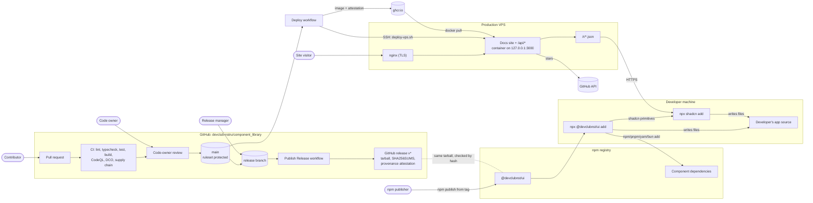

# Architecture

DevClub UI ships React components as source code. Nothing is compiled into a library. A developer copies a component's files into their own app, either with the `@devclubnst/ui` CLI or with the shadcn CLI, and owns the code from then on. This document shows every component of the project, every actor, the actions each actor takes, and the trust boundaries between them. External interfaces are specified in [INTERFACES.md](INTERFACES.md), and the threats to each flow are in [SECURITY_ASSESSMENT.md](SECURITY_ASSESSMENT.md).

## Components

| Component | Location | What it does |
| --- | --- | --- |
| Component source | `src/registry/ui/`, `src/lib/` | The `.tsx` and `.ts` files that end up in users' apps |
| Component metadata | `src/registry/components/*.json` | Name, dependencies, props and docs content for each component |
| Registry generator | [scripts/sync-registry.mjs](../scripts/sync-registry.mjs) | Inlines source into shadcn registry items. Writes `public/r/*.json`, `registry.json` and the npm-only `r/` directory. |
| Published registry | `public/r/*.json`, `registry.json` | Static JSON served at `https://ui.devclubxnst.com/r/` and bundled in the npm package |
| CLI | [bin/cli.mjs](../bin/cli.mjs) | `npx @devclubnst/ui add` and `list`. Reads the registry JSON bundled with the package. It makes no HTTP requests of its own. |
| Docs site | `src/app/` (Next.js App Router) | Component studio, docs pages and a read-only JSON API. Served at `https://ui.devclubxnst.com` from the production VPS. |
| Container image | [Dockerfile](../Dockerfile) | Builds the docs site as a Next.js standalone server on `node:22-bookworm-slim`, running as the unprivileged `node` user. Published to `ghcr.io/devclub-nstru/component_library`, tagged with the commit SHA. |
| Deploy script | [scripts/deploy-vps.sh](../scripts/deploy-vps.sh) | Runs on the VPS. Pulls an image, replaces the running container, waits for its health check, rolls back on failure and prunes old images. CI runs the same script against every PR's image. |
| CI/CD | [.github/workflows/](../.github/workflows) | Lint, typecheck, tests, builds, container image check, CodeQL, Scorecard, dependency review, DCO, the deploy workflow and the release workflow |

## Actors

| Actor | Trust | Actions |
| --- | --- | --- |
| Contributor | Untrusted | Opens issues and PRs from a fork. Their code runs in CI only after a maintainer approves the run, and only with a read-only token. |
| Code owner | Trusted | Reviews and approves PRs. One approval is needed to merge into `main`. |
| Release manager (`component-library-admins`) | Trusted | Fast-forwards `release` to a commit on `main`, which triggers the release workflow |
| npm publisher | Trusted | Runs `npm publish` for `@devclubnst/ui`. Listed in [GOVERNANCE.md](../GOVERNANCE.md). |
| GitHub Actions | Trusted, scoped | Runs workflows with a read-only `GITHUB_TOKEN` by default. Write scopes are granted per job. Only the [Deploy](../.github/workflows/deploy.yml) job can read the VPS secrets, through the `production` environment. |
| Dependabot | Semi-trusted | Opens dependency update PRs, which go through the same review and checks |
| GitHub Container Registry | Trusted third party | Stores the site's container images and their build provenance attestations |
| Production VPS | Trusted, run by the club | Runs the site container behind nginx, which terminates TLS and serves the site and `/r/*.json` |
| npm registry | Trusted third party | Hosts `@devclubnst/ui` and every dependency |
| Developer (consumer) | User | Runs the CLI or shadcn CLI in their own project and reviews the copied code |
| shadcn CLI | Third-party tool | Fetches `/r/<name>.json` over HTTPS and writes files. Our CLI also calls it to add shadcn primitives such as `avatar`. |
| Site visitor | Untrusted | Browses the docs site. |
| GitHub API | Third-party service | `/api/github/stars` reads the star count from the GitHub API. |

## Flows

### Change flow

1. A contributor opens a PR against `main`. The PR title must be a Conventional Commit, and every commit must have a DCO sign-off.
2. If the contributor is outside the org, a maintainer approves the workflow run. CI then runs on `pull_request` with a read-only token. Workflows on `pull_request_target` (labeling, title check, greeting) use only the GitHub API and never check out PR code.
3. A code owner approves. The `main` ruleset requires that approval, the 12 required checks, resolved threads, signed commits and an up-to-date branch. The PR is squash-merged.
4. The [Deploy](../.github/workflows/deploy.yml) workflow builds an image from `main`, pushes it to GHCR with a provenance attestation, and runs [scripts/deploy-vps.sh](../scripts/deploy-vps.sh) on the VPS over SSH. The script starts the new container and keeps it only if its health check passes. Otherwise it restores the previous container and the workflow fails. A final check requests `https://ui.devclubxnst.com/api/health` through nginx.

### Release flow

1. A PR bumps `version` in `package.json` and moves `[Unreleased]` in [CHANGELOG.md](../CHANGELOG.md) under the new version.
2. A release manager fast-forwards `release` to that commit on `main`.
3. [publish-release.yml](../.github/workflows/publish-release.yml) checks that `release` is on `main` and that the tag doesn't exist yet. It packs the npm tarball, writes `SHA256SUMS`, signs a build provenance attestation with Sigstore, then creates the `v<version>` tag and GitHub release with those files attached.
4. An npm publisher publishes the same version from a clean checkout of the tag.

### Install flows

- **`@devclubnst/ui` CLI.** `npx` downloads the package from npm. The CLI reads `components.json` to find the target directories, resolves the requested items and their DevClub dependencies from the bundled `public/r/`, and validates every dependency name. It refuses to write outside the UI and lib directories, writes files without overwriting unless `--overwrite` is given, and appends missing CSS variables to the Tailwind CSS file. Finally it runs the project's package manager to install npm dependencies, and `npx shadcn@latest add` for missing shadcn primitives.
- **shadcn CLI.** `npx shadcn add https://ui.devclubxnst.com/r/<name>.json` fetches the item from the production VPS over HTTPS and writes it using shadcn's own logic.

## Trust boundaries

| Boundary | What crosses it | Control |
| --- | --- | --- |
| Fork to repository | PR code and metadata | Workflow approval for outside contributors, read-only tokens, no `pull_request_target` checkout, code-owner review |
| Repository to GHCR | Container images built from `main` | The Deploy workflow's `GITHUB_TOKEN` gets `packages: write` only in the image job. Images are tagged with the commit SHA and carry a Sigstore-signed provenance attestation. PRs build the image in CI but never push it. |
| GitHub Actions to production VPS | SSH session that runs the deploy script | The SSH key, user and host are secrets of the `production` environment, which only `main` can deploy to. The host key is fetched with `ssh-keyscan` at the start of each deploy and then checked strictly for the rest of the job. The VPS pulls with a `GITHUB_TOKEN` that expires when the job ends and logs out afterwards. |
| Internet to production VPS | Visitor HTTPS requests | nginx terminates TLS and proxies to the container, which listens only on `127.0.0.1:3000`. The container runs as a non-root user with a read-only root filesystem, no Linux capabilities, and memory, CPU and process limits. |
| Repository to npm | The published tarball | Manual publish by npm maintainers. Hashes and attestations on the GitHub release let anyone compare the two. |
| npm or the docs site to developer machine | Package code, registry JSON, component source | npm integrity hashes, HTTPS, CLI validation of names and paths, developer review of copied code |
| Developer machine to package registries | Dependency installs run by the CLI | The user's own package manager and lockfile |
| Site to GitHub API | Star count | Called server-side and cached for an hour. |
